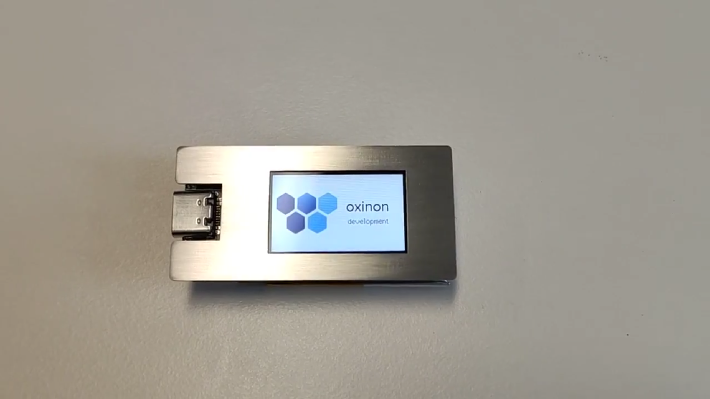

# TTGO T-Display Name Badge

A simple digital name badge built on the TTGO T-Display (ESP32 with a TFT screen), programmed with the Arduino IDE.

[Watch it in action on YouTube](https://youtu.be/ZeQcyYPs6A0)

## Hardware

- [TTGO T-Display](https://github.com/Xinyuan-LilyGO/TTGO-T-Display) (ESP32, TFT display)

## Setup

### 1. Add ESP32 support to the Arduino IDE

Follow this guide to install the ESP32 board package: <https://randomnerdtutorials.com/installing-the-esp32-board-in-arduino-ide-windows-instructions/>

In the board selector, choose **ESP32 Dev Module** for the TTGO T-Display.

**macOS users:** install the [CP210x USB to UART Bridge VCP driver](https://www.silabs.com/community/interface/knowledge-base.entry.html/2017/01/10/legacy_os_softwarea-bgvU) from Silicon Labs. The correct port is `/dev/cu.SLAB_USBtoUART` (Tools → Port).

### 2. Install the required library

Tested with Arduino IDE 1.8.8:

- [TFT_eSPI](https://github.com/Bodmer/TFT_eSPI) — display driver

Setup instructions for `TFT_eSPI` on the TTGO T-Display: <https://github.com/Xinyuan-LilyGO/TTGO-T-Display>

**Troubleshooting:** If you run into `WiFi.h` conflicts, delete the `arduino/libraries/WiFi` directory and use the ESP32 core's built-in `WiFi.h` instead.

### 3. Set your name and flash

Open `oxinon-name-badge/oxinon-name-badge.ino`, edit the displayed text/name in the sketch, select the correct board/port, and upload.

## Enclosure

The `case/` folder contains `.dxf` and `.stp` files for a stainless-steel enclosure, designed to be cut on a laser cutter.
